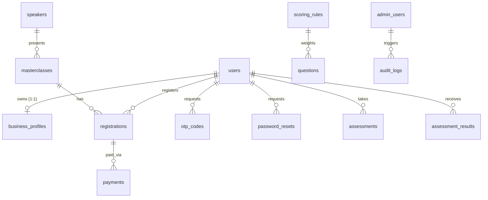

# Fundly Database Schema Reference

**Target Engine:** MySQL 8.0+ / MariaDB 10.4+  
**Default Charset:** `utf8mb4`  
**Collation:** `utf8mb4_unicode_ci`  
**Driver:** PHP PDO MySQL  

---

## 1. Overview Entity-Relationship Diagram

---

## 2. Table Specifications

### 2.1 `admin_users`
Stores administrative staff accounts with access to the admin portal.
- `id` (BIGINT UNSIGNED, AUTO_INCREMENT, PRIMARY KEY)
- `name` (VARCHAR(150), NOT NULL)
- `email` (VARCHAR(191), NOT NULL, UNIQUE)
- `password_hash` (VARCHAR(255), NOT NULL)
- `role` (VARCHAR(32), NOT NULL DEFAULT `'admin'`)
- `status` (VARCHAR(32), NOT NULL DEFAULT `'active'`)
- `last_login_at` (DATETIME, NULL)
- `created_at` (DATETIME, NOT NULL)
- `updated_at` (DATETIME, NOT NULL)

### 2.2 `users`
Stores registered SME entrepreneurs.
- `id` (BIGINT UNSIGNED, AUTO_INCREMENT, PRIMARY KEY)
- `full_name` (VARCHAR(150), NOT NULL)
- `email` (VARCHAR(191), NOT NULL, UNIQUE)
- `phone` (VARCHAR(32), NULL)
- `password_hash` (VARCHAR(255), NOT NULL)
- `status` (VARCHAR(32), NOT NULL DEFAULT `'active'`)
- `email_verified_at` (DATETIME, NULL)
- `created_at` (DATETIME, NOT NULL)
- `updated_at` (DATETIME, NOT NULL)

### 2.3 `business_profiles`
Stores business identity, trade license, TIN, financials, and debt history.
- `id` (BIGINT UNSIGNED, AUTO_INCREMENT, PRIMARY KEY)
- `user_id` (BIGINT UNSIGNED, NOT NULL, UNIQUE, FK -> `users.id` ON DELETE CASCADE)
- `business_name` (VARCHAR(255), NOT NULL)
- `business_type` (VARCHAR(64), NOT NULL)
- `industry` (VARCHAR(128), NOT NULL)
- `location` (VARCHAR(128), NOT NULL)
- `business_age` (VARCHAR(64), NOT NULL)
- `ownership_type` (VARCHAR(64), NOT NULL)
- `trade_license_no` (VARCHAR(128), NULL)
- `tin_number` (VARCHAR(128), NULL)
- `bin_vat_no` (VARCHAR(128), NULL)
- `annual_turnover` (VARCHAR(64), NULL)
- `bank_account_age` (VARCHAR(64), NULL)
- `has_audited_financials` (TINYINT(1), NOT NULL DEFAULT 0)
- `previous_loan_history` (VARCHAR(64), NULL)
- `raw_json` (TEXT, NULL)
- `created_at` (DATETIME, NOT NULL)
- `updated_at` (DATETIME, NOT NULL)

### 2.4 `speakers`
Stores industry expert instructors for Masterclasses.
- `id` (BIGINT UNSIGNED, AUTO_INCREMENT, PRIMARY KEY)
- `name` (VARCHAR(150), NOT NULL)
- `designation` (VARCHAR(150), NOT NULL)
- `institution` (VARCHAR(150), NOT NULL)
- `bio_en` (TEXT, NULL)
- `bio_bn` (TEXT, NULL)
- `photo` (VARCHAR(255), NULL)
- `created_at` (DATETIME, NOT NULL)
- `updated_at` (DATETIME, NOT NULL)

### 2.5 `masterclasses`
Stores Masterclass courses and workshop sessions.
- `id` (BIGINT UNSIGNED, AUTO_INCREMENT, PRIMARY KEY)
- `speaker_id` (BIGINT UNSIGNED, NULL, FK -> `speakers.id` ON DELETE SET NULL)
- `slug` (VARCHAR(191), NOT NULL, UNIQUE)
- `title_en` (VARCHAR(255), NOT NULL)
- `title_bn` (VARCHAR(255), NULL)
- `topic_en` (VARCHAR(128), NOT NULL)
- `topic_bn` (VARCHAR(128), NULL)
- `summary_en` (TEXT, NULL)
- `summary_bn` (TEXT, NULL)
- `description_en` (MEDIUMTEXT, NULL)
- `description_bn` (MEDIUMTEXT, NULL)
- `learn_en` (TEXT, NULL) — JSON array of learning points
- `learn_bn` (TEXT, NULL) — JSON array of learning points
- `date` (DATE, NOT NULL)
- `start_time` (VARCHAR(16), NOT NULL)
- `end_time` (VARCHAR(16), NOT NULL)
- `venue_en` (VARCHAR(255), NOT NULL)
- `venue_bn` (VARCHAR(255), NULL)
- `capacity` (INT UNSIGNED, NOT NULL DEFAULT 0)
- `registration_deadline` (DATETIME, NULL)
- `fee` (INT UNSIGNED, NOT NULL DEFAULT 0)
- `cover` (VARCHAR(255), NULL)
- `cover_tone` (VARCHAR(32), NOT NULL DEFAULT `'leaf'`)
- `status` (VARCHAR(32), NOT NULL DEFAULT `'draft'`)
- `created_at` (DATETIME, NOT NULL)
- `updated_at` (DATETIME, NOT NULL)

### 2.6 `registrations`
Stores registrations for Masterclasses with seat reservations and unique confirmation codes.
- `id` (BIGINT UNSIGNED, AUTO_INCREMENT, PRIMARY KEY)
- `user_id` (BIGINT UNSIGNED, NOT NULL, FK -> `users.id` ON DELETE CASCADE)
- `masterclass_id` (BIGINT UNSIGNED, NOT NULL, FK -> `masterclasses.id` ON DELETE RESTRICT)
- `registration_code` (VARCHAR(32), NOT NULL, UNIQUE) — e.g. `FL-A9B2C4`
- `status` (VARCHAR(32), NOT NULL DEFAULT `'confirmed'`)
- `payment_status` (VARCHAR(32), NOT NULL DEFAULT `'unpaid'`)
- `participant_name` (VARCHAR(150), NULL)
- `participant_phone` (VARCHAR(32), NULL)
- `participant_designation` (VARCHAR(128), NULL)
- `business_name` (VARCHAR(255), NULL)
- `created_at` (DATETIME, NOT NULL)
- `updated_at` (DATETIME, NOT NULL)
- **Constraint:** UNIQUE(`user_id`, `masterclass_id`)

### 2.7 `payments`
Tracks financial transactions and payment gateway integration callbacks.
- `id` (BIGINT UNSIGNED, AUTO_INCREMENT, PRIMARY KEY)
- `registration_id` (BIGINT UNSIGNED, NOT NULL, FK -> `registrations.id` ON DELETE CASCADE)
- `user_id` (BIGINT UNSIGNED, NOT NULL, FK -> `users.id` ON DELETE CASCADE)
- `provider` (VARCHAR(32), NOT NULL DEFAULT `'bkash'`)
- `payment_id` (VARCHAR(128), NOT NULL, UNIQUE)
- `transaction_id` (VARCHAR(128), NULL, UNIQUE)
- `amount` (INT UNSIGNED, NOT NULL)
- `currency` (VARCHAR(10), NOT NULL DEFAULT `'BDT'`)
- `status` (VARCHAR(32), NOT NULL DEFAULT `'pending'`)
- `payload` (TEXT, NULL)
- `created_at` (DATETIME, NOT NULL)
- `updated_at` (DATETIME, NOT NULL)

### 2.8 `scoring_rules`
Defines the 6 categories, weight distribution, and readiness threshold logic.
- `id` (BIGINT UNSIGNED, AUTO_INCREMENT, PRIMARY KEY)
- `category_key` (VARCHAR(64), NOT NULL, UNIQUE)
- `name_en` (VARCHAR(128), NOT NULL)
- `name_bn` (VARCHAR(128), NOT NULL)
- `weight` (INT UNSIGNED, NOT NULL DEFAULT 0)
- `description_en` (TEXT, NULL)
- `description_bn` (TEXT, NULL)
- `created_at` (DATETIME, NOT NULL)
- `updated_at` (DATETIME, NOT NULL)

### 2.9 `questions`
20 official eligibility questions with multi-option points and recommendations.
- `id` (BIGINT UNSIGNED, AUTO_INCREMENT, PRIMARY KEY)
- `code` (VARCHAR(64), NOT NULL, UNIQUE)
- `category` (VARCHAR(64), NOT NULL)
- `prompt_en` (TEXT, NOT NULL)
- `prompt_bn` (TEXT, NOT NULL)
- `help_en` (TEXT, NULL)
- `help_bn` (TEXT, NULL)
- `options_json` (TEXT, NOT NULL)
- `weight` (INT UNSIGNED, NOT NULL DEFAULT 1)
- `is_active` (TINYINT(1), NOT NULL DEFAULT 1)
- `order_index` (INT UNSIGNED, NOT NULL DEFAULT 0)
- `created_at` (DATETIME, NOT NULL)
- `updated_at` (DATETIME, NOT NULL)

### 2.10 `assessments`
Tracks in-progress draft answers.
- `id` (BIGINT UNSIGNED, AUTO_INCREMENT, PRIMARY KEY)
- `user_id` (BIGINT UNSIGNED, NOT NULL, FK -> `users.id` ON DELETE CASCADE)
- `current_step` (INT UNSIGNED, NOT NULL DEFAULT 1)
- `answers_json` (TEXT, NOT NULL)
- `status` (VARCHAR(32), NOT NULL DEFAULT `'draft'`)
- `created_at` (DATETIME, NOT NULL)
- `updated_at` (DATETIME, NOT NULL)

### 2.11 `assessment_results`
Calculated readiness scores and breakdown results.
- `id` (BIGINT UNSIGNED, AUTO_INCREMENT, PRIMARY KEY)
- `user_id` (BIGINT UNSIGNED, NOT NULL, FK -> `users.id` ON DELETE CASCADE)
- `score` (INT UNSIGNED, NOT NULL)
- `band` (VARCHAR(32), NOT NULL) — `low` | `needs_improvement` | `moderate` | `stronger`
- `category_scores_json` (TEXT, NOT NULL)
- `priority_gaps_json` (TEXT, NULL)
- `created_at` (DATETIME, NOT NULL)

### 2.12 `otp_codes` & `password_resets`
Security tokens for authentication flows.
- `otp_codes`: `email`, `otp_hash`, `purpose`, `attempts`, `expires_at`, `created_at`
- `password_resets`: `email`, `token_hash`, `expires_at`, `used_at`, `created_at`

### 2.13 `login_attempts` & `audit_logs`
- `login_attempts`: `email`, `ip`, `attempted_at` (throttled at 5 failed attempts in 15 minutes)
- `audit_logs`: `actor_type`, `actor_id`, `action`, `entity_type`, `entity_id`, `ip`, `created_at`
